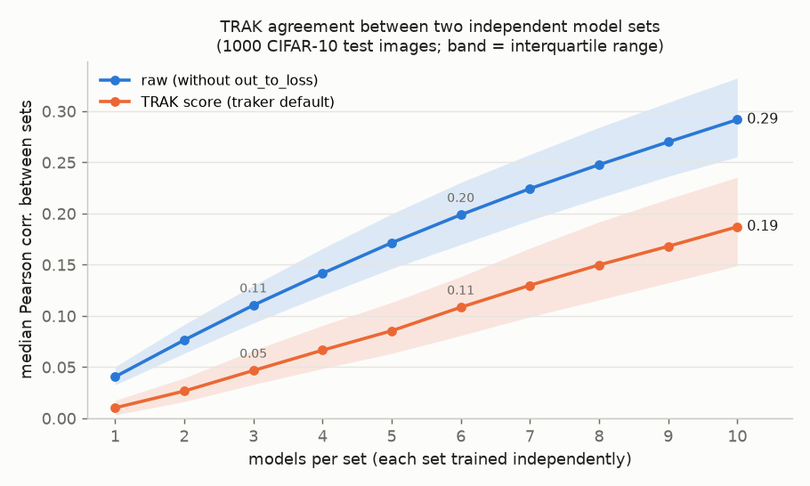

# Retrace experiment log

*Everything AI learned has an owner.* Data-attribution experiments toward creator compensation: what we ran, and what we found.

How to add or edit posts: [HOW_TO_EDIT.md](HOW_TO_EDIT.md)

## Experiments

| date | experiment | one-line conclusion | details |
|---|---|---|---|
| 2026-11-11 | TRAK on CIFAR-10: quickstart, top-5, duplicate test | Inconclusive: retraining alone moves A from rank 1 to 29,512, so the copy's effect can't be measured with 3 models | [part 1](posts/2026-11-11-trak-cifar10-quickstart-and-duplicate.md) |
| 2026-11-11 | TRAK noise diagnosis: Q factor, projection seed, model count, checkpoint ensemble | Final-only checkpoints break label agreement (via Q). Instability comes from too few ensemble members: agreement 0.045 → 0.22 with 3 → 15 members | [part 2](posts/2026-11-11-trak-noise-diagnosis.md) |
| next | LDS, small scale (20 × 50% subsets) | Planned. Estimate: 15–17 GPU-minutes with 1 model per subset, 45–50 with 3 | – |

## Headline numbers (TRAK, CIFAR-10, ResNet-9, `proj_dim=2048`)

| TRAK ensemble per set | members | agreement between independent sets | same-label top-5 | top-1 attributions in top-1% Q |
|---|---|---|---|---|
| final checkpoint, 3 models | 3 | 0.045 | 0.20 | 99.9% |
| final checkpoint, 6 models | 6 | 0.108 | 0.33 | – |
| final checkpoint, 10 models | 10 | 0.187 | 0.51 | 94.5% |
| 3 models × 5 checkpoints (quickstart) | 15 | **0.223** | **0.90** | **30.5%** |

- **Agreement:** the median, over 1,000 test images, of the Pearson correlation between two independently trained sets' scores across the 50k training images.
- **Q:** 1 − p(true class) for a training image. traker multiplies every score by its average Q.

## Where things are

- Posts: [`posts/`](posts/)
- Figures: [`assets/img/`](assets/img/)
- Experiment code and full numbers: [`experiments/trak_cifar10/`](../experiments/trak_cifar10/)
