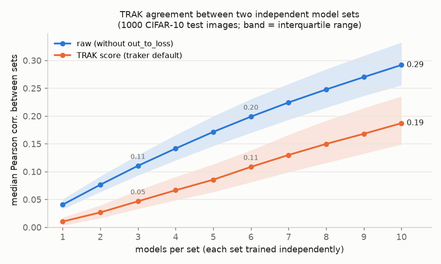

# TRAK on CIFAR-10, part 2: why the scores were unstable

*2026-11-11 · trak, cifar10, noise, ensemble* · [← dashboard](../README.md)

**Bottom line:** using only final checkpoints explains why the top attributions ignore the class label. The instability has a different cause: too few ensemble members. Agreement between two independently trained sets rises from 0.045 to 0.22 as members go from 3 to 15, and it is still rising.

## 1. A's 23.67 → 0.029 was not a scale problem

In `traker` 0.3.2, a TRAK score is a product of two averages over models:

> score = mean(features · target gradient) × mean(Q), where Q = 1 − p(true class) for the training image

- **The overall score scale didn't change.** Score std is 0.29, 0.26 and 0.25 across the three runs.
- **A's score came from one model.** In the base run, model 2 fits A badly (Q = 0.83), while the median Q is about 0.0003. That one model pushed A to rank 1.
- **The rank was fragile.** Re-featurizing the same 3 checkpoints (only the random flip changes) gives A rank 1,381.

With final checkpoints, Q decides almost everything:

| base run, 1,000 test images | value |
|---|---|
| top-1 attributions that are in the top 1% by Q | 99.9% |
| distinct top-1 training images | 70 |
| same-label top-5, TRAK score | 0.20 |
| same-label top-5, without Q | 0.97 |

## 2. Where the noise comes from

Same 3 base models. Each row changes one more thing than the row above it.

| compared with the base run | score corr | corr without Q |
|---|---|---|
| re-featurize (only the random flip differs) | 0.48 | 0.61 |
| + new projection seed | 0.11 | 0.16 |
| + retrain with new seeds | 0.045 | 0.11 |

Projection noise alone takes agreement most of the way down.

## 3. More models help, with no plateau yet

| models per set | score corr | corr without Q | same-label top-5 |
|---|---|---|---|
| 3 | 0.047 | 0.110 | 0.21 |
| 6 | 0.108 | 0.199 | 0.33 |
| 10 | 0.187 | 0.292 | 0.51 |

## 4. The quickstart's checkpoint ensemble

Each set: 3 models × checkpoints at epochs 12, 15, 18, 21 and 23 = 15 members. The formula is unchanged.

| per set | Q concentration | same-label top-5 | score corr |
|---|---|---|---|
| final only, 3 models | 0.999 | 0.20 | 0.045 |
| final only, 10 models | 0.945 | 0.51 | 0.187 |
| **3 models × 5 checkpoints** | **0.31** | **0.90** | **0.223** |
| epoch 12 only, 3 models | 0.43 | 0.63 | 0.067 |

- Earlier checkpoints spread Q out, which fixes label agreement.
- Any single-epoch ensemble of 3 still has agreement around 0.05.
- So the stability gain comes from having more members, not from the epochs they come from.

## What's next

- **LDS:** 20 subsets of 50% of the training set, 1 model each, is about 15–17 min of GPU time. With 3 models per subset, it's 45–50 min.
- **Redo the duplicate test with ≥ 15 ensemble members.** Or keep the models fixed and add only the copy's features, with the flip turned off.

Code: [`experiments/trak_cifar10/analyze2.py`](../../experiments/trak_cifar10/analyze2.py) · full numbers: [`experiments/trak_cifar10/README.md`](../../experiments/trak_cifar10/README.md#round-2-2026-11-11-afternoon-why-the-scores-are-unstable)
