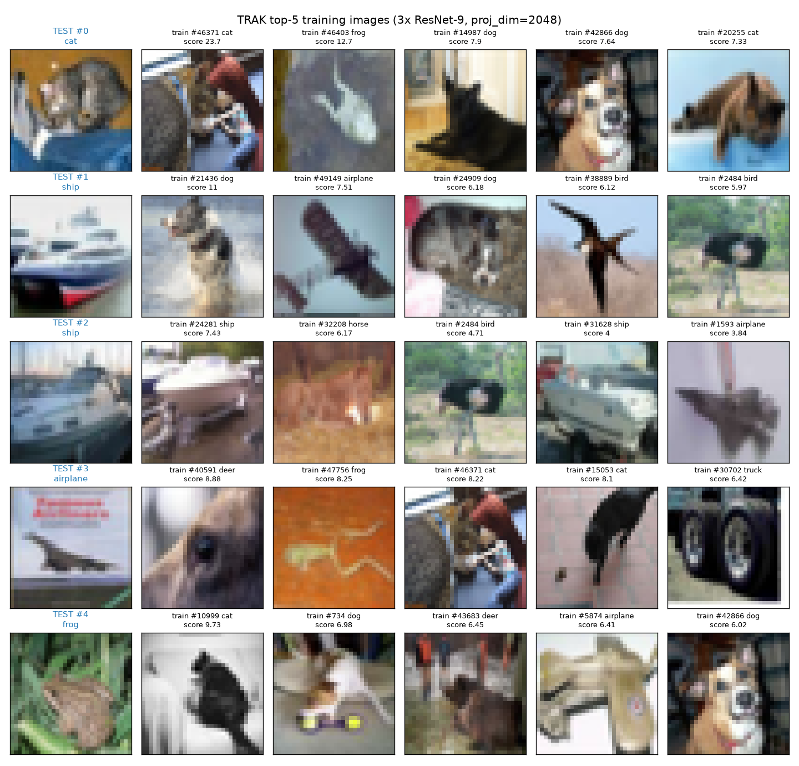
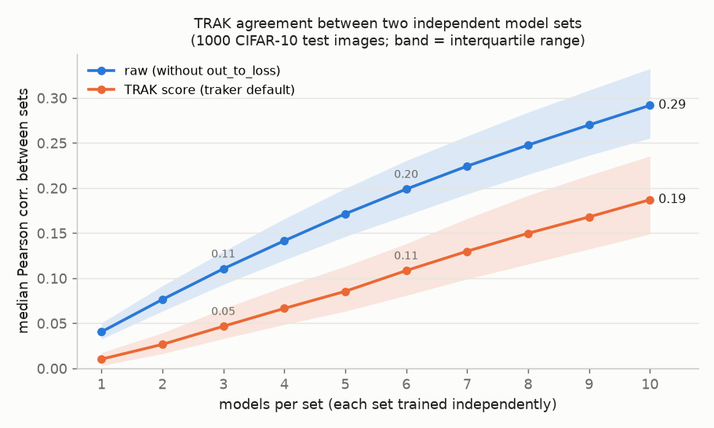

# TRAK on CIFAR-10 (ResNet-9)

First hands-on run of TRAK (`traker` 0.3.2, https://trak.readthedocs.io) on a fast setting, before moving to generative (music) models.

## Result in one line

The setup runs end to end. With 3 models, though, TRAK scores do not reproduce across retraining (median correlation 0.04 between two independent 3-model runs), so the duplicate experiment **cannot tell** whether A's attribution is split with its copy. The control run shows A loses its rank-1 score even without a copy.

Round 2 ([below](#round-2-2026-11-11-afternoon-why-the-scores-are-unstable)):
- **A's 23.67 is not a scale problem.** One model fits A badly, so its Q = 1 − p is high, and Q multiplies the whole score.
- **Final-only checkpoints concentrate Q.** That is why top attributions ignore the label. The quickstart's 5-checkpoint ensemble fixes this: same-label top-5 goes from 0.20 to 0.90.
- **Instability comes from too few ensemble members**, not from Q: projection, flip and retraining noise each contribute. Agreement rises from 0.045 with 3 members to 0.19 with 10 and 0.22 with 15, and is still rising.

## Setup

| item | value |
|---|---|
| model | ResNet-9 (`construct_rn9`, verbatim from the quickstart) |
| training | quickstart hyperparameters: SGD lr 0.4, momentum 0.9, wd 5e-4, 24 epochs, triangular LR (peak epoch 5), batch 512, flip augmentation, AMP |
| models | 3 independently trained, TRAK uses each model's final checkpoint (epoch 23) |
| TRAK | `task='image_classification'`, `proj_dim=2048`, CUDA projector (`fast_jl`), featurize batch 128, all 10,000 test images as targets |
| hardware | 1× RTX 3080 20 GB (shared). One run (3 models + TRAK) ≈ 7 min: training ≈ 1.5 min/model, TRAK ≈ 2.5 min |

Deviations from the official quickstart:
- The notebook trains **1** model and uses its 5 intermediate checkpoints (epochs 12/15/18/21/23) as 5 `model_id`s. Here: 3 models × final checkpoint, as requested. (The docs prose says "three models"; its code trains one.)
- `proj_dim=2048` (notebook: 4096; docs default: 2048).
- `torch.amp` instead of deprecated `torch.cuda.amp`.
- Kept from the quickstart: the featurization loader uses `augment=True` (random horizontal flip) on training images.

Environment note: `fast_jl` 0.1.3 does not build against CUDA 13 because its `setup.py` hard-codes `TORCH_CUDA_ARCH_LIST="7.0+PTX"` (CUDA 13 dropped `compute_70`). It was built from the sdist with the arch changed to `8.6` (`/workspace/shared/hyuntae/build_fastjl/`). Check: on vectors with known cosine (1, 0.9, 0.5, 0, −0.5), the CUDA projector gives (1.0, 0.897, 0.494, −0.042, −0.517) and `BasicProjector` gives (1.0, 0.901, 0.521, 0.0, −0.514).

## Test accuracy

| run | model 0 | model 1 | model 2 |
|---|---|---|---|
| base (seeds 0–2, 50,000 train) | 0.9174 | 0.9185 | 0.9166 |
| dup (seeds 0–2, 50,001 train = + copy of A) | 0.9163 | 0.9148 | 0.9176 |
| control (seeds 3–5, 50,000 train) | 0.9146 | 0.9154 | 0.9177 |

## 1. Top-5 figure



Test images #0–#4 (first five of the CIFAR-10 test set), base run.
- The fraction of top-5 training images that share the test image's label is 0.20 for the base run (first 1,000 test images); chance is 0.10.
- Train #46371 is top-3 for both test #0 (cat) and test #3 (airplane). Train #42866 is top-5 for both test #0 and test #4.

## 2. Duplicate experiment

Target: test #0 (cat). A = its top-1 training image in the base run, train #46371 (cat). The dup run appends a copy of A at index 50000, then retrains the 3 models (seeds 0–2) and recomputes TRAK.

| quantity | score | rank |
|---|---|---|
| base: A | 23.67 | 1 / 50,000 |
| dup: A (original) | 0.034 | 8,403 / 50,001 |
| dup: copy of A | −0.0046 | 36,751 / 50,001 |
| dup: A + copy | 0.029 | – |
| **control** (no copy, seeds 3–5): A | −0.00009 | 29,512 / 50,000 |

How stable the scores are across runs:

| comparison | Pearson corr. of scores over 50k training images |
|---|---|
| base vs dup, test #0 | 0.064 |
| base vs control, test #0 | 0.040 |
| base vs dup, first 200 test images (median) | 0.047 |
| base vs control, first 200 test images (median) | 0.044 |

The top-6 training images for test #0 share no images across base, dup and control (full lists are in `dup_results.md`).

Facts:
- Without a copy, retraining alone drops A from score 23.7 (rank 1) to ≈0 (rank 29,512).
- So the drop in the dup run (A + copy = 0.029) cannot be separated from retraining noise.
- Within the dup run, A and its copy are the same image but score differently (0.034 vs −0.0046). Two things in this setup can cause that: the random flip applied during featurization, and score noise.

Inference (mine, not tested):
- With 3 models, between-run noise dominates, so this design cannot measure "credit splitting". Two fixes:
  - (a) Many more models, so retraining noise averages out. The TRAK paper uses far more than 3; the exact number needed here is unknown.
  - (b) Isolate the attribution formula's effect: keep the base models fixed, add only the copy's features, and featurize with `augment=False` so A and the copy get identical features.

## Round 2 (2026-11-11 afternoon): why the scores are unstable

Analysis code: `analyze2.py`. Unless noted, "corr" means the median, over the first 1,000 test images, of the per-test Pearson correlation computed across the 50k training images.

### 2.1 Why A's score went from 23.67 to 0.029

There is **no global scale change, no normalization issue, no soft-threshold, and no code bug**.

- **Score formula** (`traker` 0.3.2 `finalize_scores`, `traker.py:676`): score = mean over models of (features · target grad) × mean over models of `out_to_loss`.
  - Here `out_to_loss` = Q = 1 − p(true class) for each training image (`modelout_functions.py:445`).
  - The code has no soft-threshold, and `lambda_reg` defaults to 0.
  - Rebuilding the scores from the stored per-model factors matches traker's saved scores (max abs error 0.015, from fp16 storage).
- **The overall scale is unchanged.** Score std over the 50k training images is 0.29 (base), 0.26 (dup) and 0.25 (control).
- **A's score came from one model.**

  | run | raw dot product for A (rank) | Q(A), per model | Q̄(A) (rank of 50k) | score |
  |---|---|---|---|---|
  | base | 84.7 (207) | 0.004, 0.003, **0.83** | 0.28 (9) | 23.66 |
  | dup | 16.8 (13,457) | 0.004, 0.0004, 0.002 | 0.002 (17,142) | 0.034 |
  | control | −0.01 (25,466) | 0.013, 0.008, 0.002 | 0.008 (6,925) | −0.0001 |

  Base model 2 fits A poorly (p(cat) = 0.17), while the median Q per model is about 0.0003. So in the base run, A's Q̄ is about 460× the median, and that drives the rank-1 score. A's raw dot product ranks only 207th.
- **This depends on the random flip.** The same 3 base checkpoints, re-featurized in the 5-checkpoint run (epoch-23 subset, different random flips), give A rank 1,381 with score 0.38.
- **Q drives top attributions in general** (base run, first 1,000 test images):
  - 99.9% of top-1 attributions are training images in the top 1% by Q.
  - Only 70 distinct training images are top-1 across the 1,000 test images.
  - Top-5 same-label agreement is 0.20 for the score and 0.97 for the raw dot product.
- **Within the dup run, A and its copy are identical whenever their flips match.** In dup model 1, A and the copy have identical raw values (76.11 each) and identical Q; in models 0 and 2 they differ.

### 2.2 Projection noise vs retraining noise

Reference: the base run (3 models, seeds 0–2, projection seed 0).

| base vs … | what differs | corr score | corr raw | corr Q̄ |
|---|---|---|---|---|
| `base_proj0b` | random flip during featurization only (same models, same projection seed) | 0.484 | 0.605 | 0.747 |
| `base_proj1` | flip + projection seed (1) | 0.107 | 0.160 | 0.720 |
| `ctrl` | flip + projection + retraining (seeds 3–5) | 0.045 | 0.110 | 0.500 |

- With 3 models, changing only the projection seed already drops score agreement to 0.11, about 2.4× the retraining level of 0.045.
- The quickstart's featurization flip alone drops it to 0.48.

### 2.3 Agreement vs number of models

Setup:
- Two independent sets: set 1 is seeds 0–2 plus 103–109, set 2 is seeds 3–5 plus 203–209.
- Final checkpoints only, projection seed 0, re-featurized.
- Test accuracy of all 20 models: 91.3–91.9%.



| models per set | corr score (IQR) | corr raw (IQR) | corr Q̄ | same-label top-5, score (set 1) |
|---|---|---|---|---|
| 3 | 0.047 (0.033–0.066) | 0.110 (0.093–0.130) | 0.50 | 0.21 |
| 6 | 0.108 (0.081–0.138) | 0.199 (0.170–0.230) | 0.65 | 0.33 |
| 10 | 0.187 (0.149–0.236) | 0.292 (0.255–0.332) | 0.76 | 0.51 |

Agreement is still rising roughly linearly at 10 models; no plateau is visible. Numbers for every model count from 1 to 10 are in `round2_scaling.json`.

### 2.4 Quickstart-style checkpoint ensemble (epochs 12, 15, 18, 21, 23)

Setup:
- Each set uses its 3 models × 5 checkpoints = 15 `model_id`s.
- The original formula is kept, Q included.
- Set 1 is seeds 0–2, set 2 is seeds 3–5.
- "Q conc." = fraction of top-1 attributions that are training images in the top 1% by Q̄.

| ensemble per set | featurizations | Q conc. (set 1 / set 2) | distinct top-1 (of 1,000) | same-label top-5 (score) | corr score | corr raw |
|---|---|---|---|---|---|---|
| final only, 3 models | 3 | 0.999 / 0.997 | 70 | 0.20 | 0.045 | 0.110 |
| final only, 10 models | 10 | 0.945 / 0.947 | 260 | 0.51 | 0.187 | 0.292 |
| **3 models × 5 ckpts (quickstart)** | 15 | **0.305 / 0.316** | 780 | **0.90** | **0.223** | 0.308 |
| epoch 12 only, 3 models | 3 | 0.43 / 0.45 | 729 | 0.63 | 0.067 | 0.112 |
| epoch 15 only, 3 models | 3 | 0.57 / 0.63 | 623 | 0.52 | 0.053 | 0.107 |
| epoch 18 only, 3 models | 3 | 0.81 / 0.83 | 408 | 0.41 | 0.039 | 0.108 |
| epoch 21 only, 3 models | 3 | 0.995 / 0.997 | 131 | 0.24 | 0.037 | 0.111 |
| epoch 23 only, 3 models | 3 | 0.998 / 0.998 | 86 | 0.21 | 0.049 | 0.111 |

Median Q̄ is 0.031 for the 5-checkpoint ensemble and 0.0006 for final-only (3 models). Test #0, A = #46371: rank 24 (score 7.31) with 5 checkpoints, rank 17 (score 1.60) with 10 final-only models. Full numbers are in `round2_ckpt5.md`.

Facts:
- Earlier checkpoints have less concentrated Q and better label agreement (epoch 12: 0.43 and 0.63; epoch 23: 0.998 and 0.21).
- For single-epoch ensembles, cross-set agreement stays at 0.04–0.07 at every epoch. Raw agreement stays at about 0.11 at every epoch.
- The 5-checkpoint ensemble's agreement (0.223 score, 0.308 raw) is about the same as 10 final-only models (0.187, 0.292).

Inference (mine):
- Using only final checkpoints explains the **label mismatch** (Q concentration). It does **not** explain the **instability**.
- Stability tracks the number of ensemble members (15 vs 3), because averaging reduces projection, flip and retraining noise. Raw scores, which have no Q, improve by the same amount.

### 2.5 LDS cost estimate (not run)

Inputs:
- **Measured:** training one model on 50k images takes 89–94 s, including a 10k-image test pass (gaps between checkpoint timestamps, 20 models).
- **Assumed, not measured:** a 25k (50%) subset takes about half as long, roughly 45–50 s, because the number of iterations halves. Data-loader overhead may not halve.
- Margins on 1,000 test images per model take a few seconds, and scoring the LDS from existing TRAK scores runs on CPU. Both are negligible.

| design | GPU time |
|---|---|
| 20 subsets × 1 model | ≈ 15–17 min |
| 20 subsets × 3 models (averages retraining noise) | ≈ 45–50 min |
| 20 subsets × 5 models | ≈ 75–85 min |

Unknown: how many subsets and models per subset the TRAK paper's LDS protocol uses (not checked).

Disk: `/workspace/shared/hyuntae/trak_results` is now 19 GB, and 66 GB of 100 GB is still free.

## Files

Code (here):
- `trak_cifar.py`: training and TRAK.
  - `train|trak --tag {base,dup,ctrl} [--dup-index 46371] [--seed-offset 3]`
- `analyze.py`: figure and duplicate table.
  - `pick`: choose the target test image and A.
  - `figure`: make the top-5 figure.
  - `dup --dup-index 46371`: build the duplicate table.
- `analyze2.py`: round-2 analysis.
  - `scale_diag`: why A's score changed.
  - `proj`: projection vs flip vs retraining noise.
  - `scaling`: agreement vs number of models, and `scaling_corr.png`.
  - `ckpt5`: the checkpoint-ensemble comparison.
- `round2_*.json|md`: raw round-2 numbers.
- `top5_trak.png`: the top-5 figure.
- `dup_results.md`: raw numbers for the duplicate table.

Not committed (`/workspace/shared/hyuntae/`):
- `data/`: CIFAR-10.
- `checkpoints/{base,dup,ctrl}/`: `sd_{i}_epoch_{12,15,18,21,23}.pt` and `test_acc.json`.
- `trak_results/{base,dup,ctrl}/`: TRAK features; scores are in `scores/quickstart.mmap` with shape (train, test).
- `logs/`: run logs.
- `.venv/`: Python 3.12, torch 2.14.1+cu130, traker 0.3.2, fast_jl 0.1.3 (built for sm_86).
- `build_fastjl/`: the patched `fast_jl` build.

Reproduce:
```bash
source /workspace/shared/hyuntae/.venv/bin/activate
python trak_cifar.py train --tag base && python trak_cifar.py trak --tag base
python analyze.py pick && python analyze.py figure
python trak_cifar.py train --tag dup --dup-index 46371 && python trak_cifar.py trak --tag dup --dup-index 46371
python trak_cifar.py train --tag ctrl --seed-offset 3 && python trak_cifar.py trak --tag ctrl
python analyze.py dup --dup-index 46371
# round 2: the full command list is in the docstring of trak_cifar.py (proj seed, extra models, scale_*, ckpt5_*)
python analyze2.py scale_diag && python analyze2.py proj && python analyze2.py scaling && python analyze2.py ckpt5
```
Both `train` and `trak` exit if `nvidia-smi` shows another process on the GPU.
